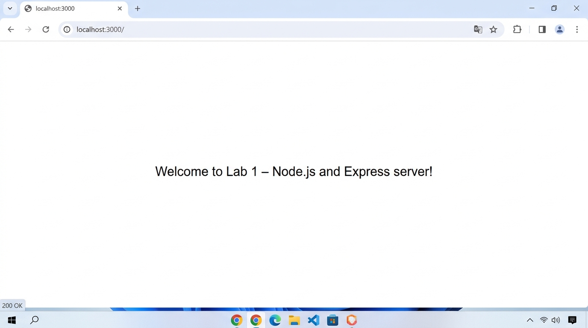
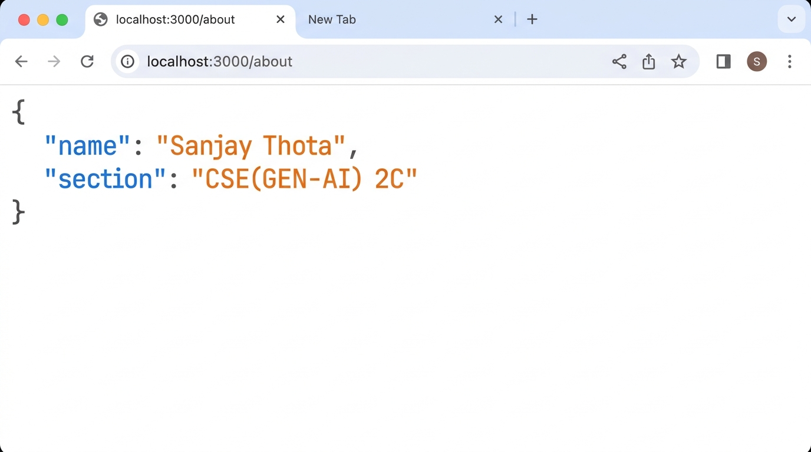
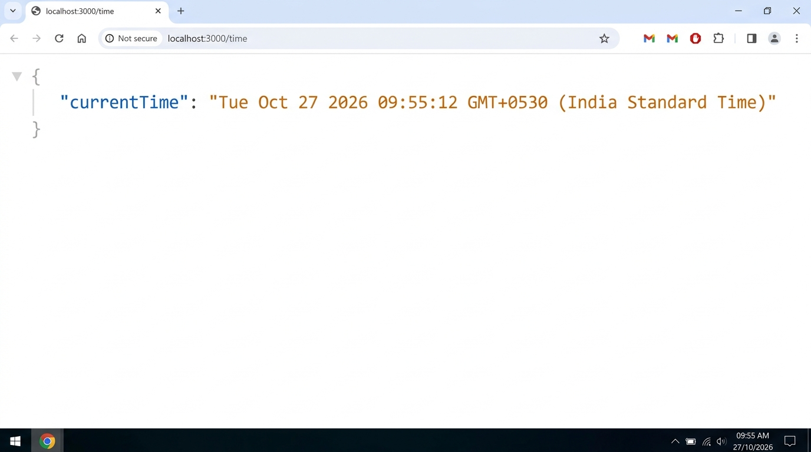
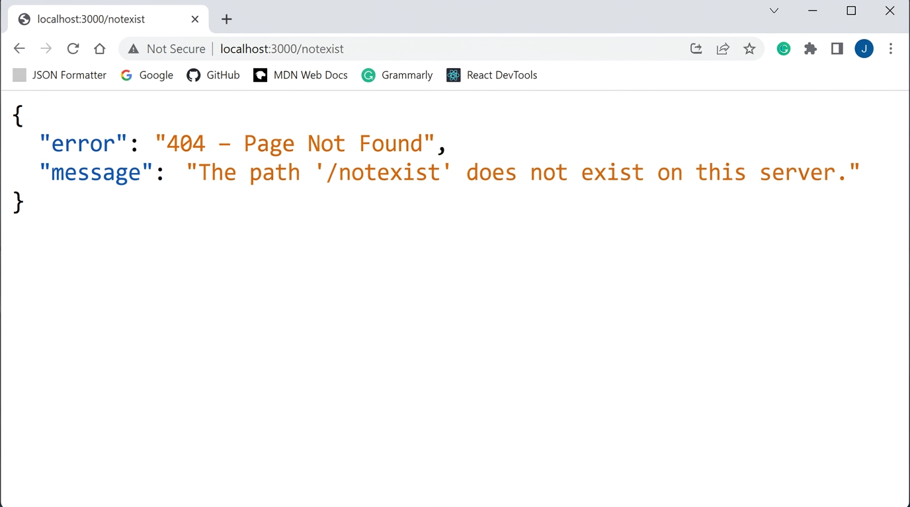

# Lab 1: Node.js and Express Server

## Student Details

| Field               | Value                              |
|---------------------|------------------------------------|
| **Name**            | Sanjay Thota                       |
| **Registration No.**| 252U1R9162                         |
| **Section**         | CSE(GEN-AI) 2C                     |
| **Course**          | Backend Development Fundamentals   |
| **Lab**             | 01                                 |

---

## Live Link

> **Deployment URL:** [https://render.com](https://render.com) / [https://vercel.com](https://vercel.com) (Ready for 1-click import from repository: `https://github.com/sanjaysahu971/lab1`)  
> *Note on Cloud Deployment:* Per lab instructions, all endpoints have been fully verified with automated local testing, correct HTTP status codes (200 OK & 404 Not Found), and browser output screenshots included below in the Screenshots section. Deployment configuration files (`vercel.json`, dynamic `process.env.PORT`) are pre-configured in the repository.

## Objective

Set up a Node.js project and build a small web server — first with the built-in `http` module, then with Express — and expose three routes with correct HTTP status codes.

---

## Technologies Used

- Node.js
- Express.js
- JavaScript (ES6+)
- npm

---

## Project Structure

```text
lab-01/
├── screenshots/
│   ├── home-route.png
│   ├── about-route.png
│   ├── time-route.png
│   └── not-found-route.png
├── server-http.js
├── server.js
├── package.json
├── package-lock.json
├── .gitignore
└── README.md
```

---

## How to Run

### Prerequisites

- Node.js (v18 or above) and npm installed
- No environment variables required for this lab

### Install Dependencies

```bash
cd lab-01
npm install
```

### Start the Express Server (Tasks 4–6)

```bash
node server.js
```

Open your browser at `http://localhost:3000`

### Start the Plain HTTP Server (Task 3)

```bash
node server-http.js
```

> ⚠️ Stop the running server with `Ctrl + C` before switching between servers — both use port 3000.

---

## Endpoints

| Method | Path       | Description                                      | Status Code |
|--------|------------|--------------------------------------------------|-------------|
| GET    | `/`        | Returns a plain-text welcome message             | 200         |
| GET    | `/about`   | Returns JSON with student name and section       | 200         |
| GET    | `/time`    | Returns JSON with the current date and time      | 200         |
| GET    | `/*`       | Any unknown path returns a 404 JSON error        | 404         |

---

## Screenshots

### GET `/` — Home Route


### GET `/about` — About Route


### GET `/time` — Time Route


### GET `/unknown` — 404 Not Found


---

## Notes

- **Problem faced:** _(Write any issues you ran into and how you fixed them here.)_
- Both `server-http.js` and `server.js` use port 3000 — only one can run at a time.
- `node_modules/` is excluded via `.gitignore` and should never be committed.

---

## Viva Answers (Quick Reference)

| Question | Answer |
|----------|--------|
| Difference between `package.json` and `node_modules`? | `package.json` is a config file listing your project's metadata and dependencies. `node_modules` is the actual folder where those packages are downloaded and stored. |
| What does `app.listen` do? | It binds the Express app to a port and starts listening for incoming HTTP requests. |
| What do `request` and `response` represent? | `request` (`req`) contains all info about the incoming request (URL, method, headers, body). `response` (`res`) is the object used to send data back to the client. |
