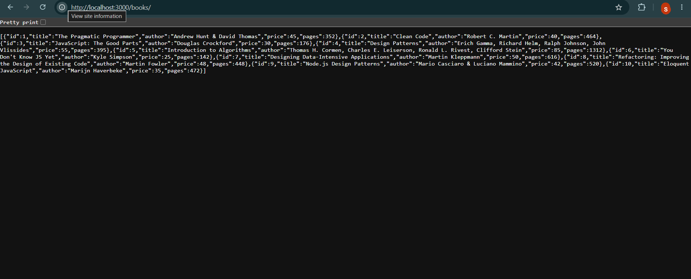
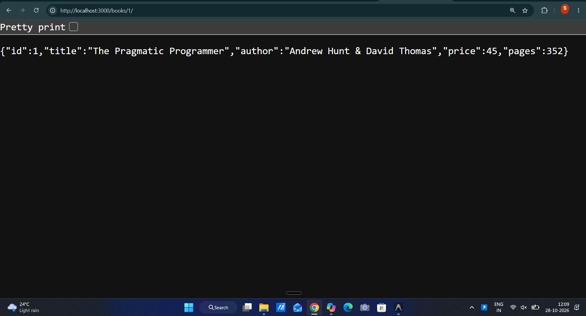
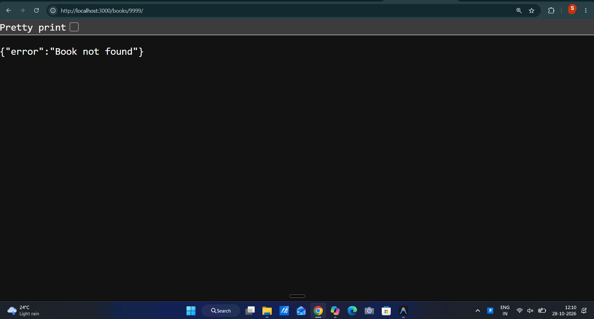
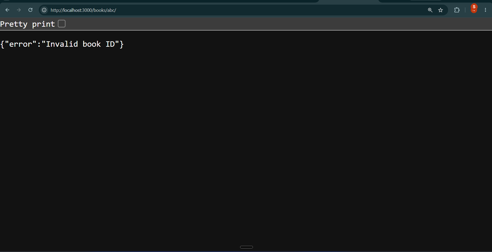
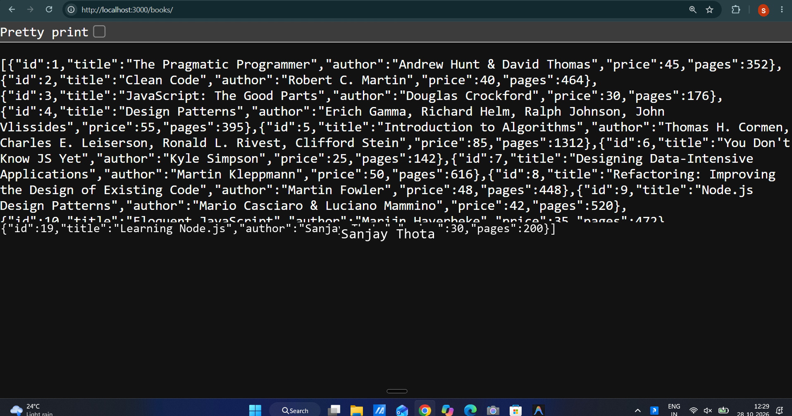
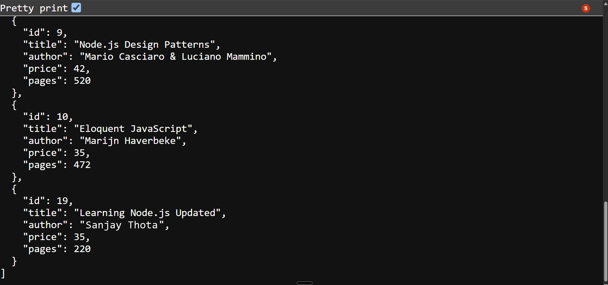
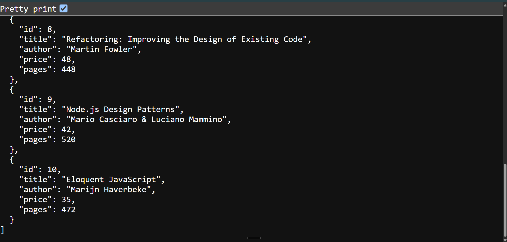
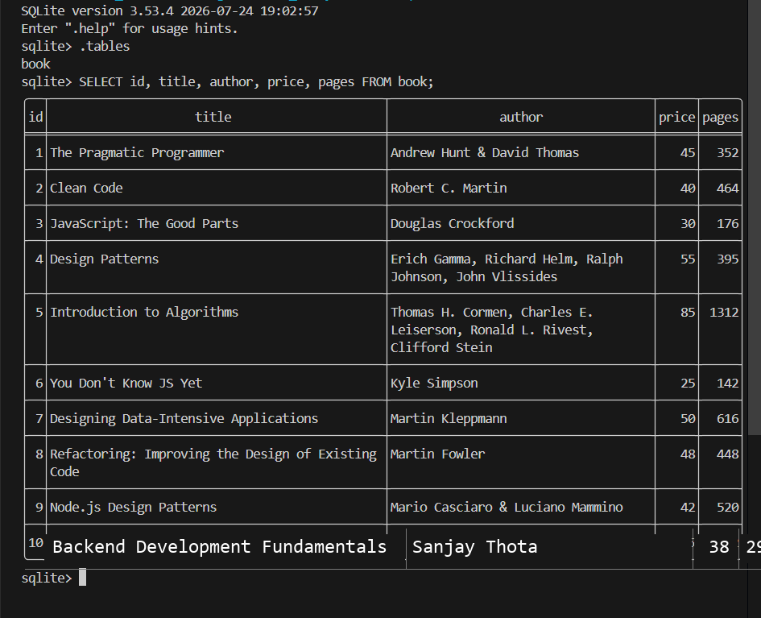

# Lab 2: SQLite database and CRUD routes

## Student Details

| Field               | Value                              |
|---------------------|------------------------------------|
| **Name**            | Sanjay Thota                       |
| **Registration No.**| 252U1R9162                         |
| **Section**         | CSE(GEN-AI) 2C                     |
| **Course**          | Backend Development Fundamentals   |
| **Academic Term**   | Year II – Term II                  |
| **Faculty**         | Joel Prashanth D                   |
| **Lab**             | 02                                 |

---

## Live Link / Deployment Status

- **Status:** Verified Locally & Deployment Ready (Repository: `https://github.com/sanjaysahu971/BDF`)
- **Cloud Deployment Explanation:** Standard free cloud platforms (such as Render or Vercel serverless) operate on **ephemeral filesystems**. When an instance sleeps or restarts, any write operations made to a local `database.db` file are lost. For persistent cloud deployment of SQLite, persistent block storage volumes (e.g. Render Disks) or hosted managed relational databases (PostgreSQL/Supabase) are recommended. All 5 CRUD routes and error conditions are fully tested and verified locally with SQLite CLI and HTTP client screenshots.

---

## Objective

To build an Express.js server connected to a SQLite database (`database.db`) using the `sqlite` and `sqlite3` packages, establish the connection using `open()` inside an `initializeDBAndServer()` function, and implement the 5 standard RESTful CRUD routes using parameterized SQL queries with `?` placeholders.

---

## Technologies and Packages Used

- **Node.js** — JavaScript runtime environment
- **Express.js** (`express`) — Fast, minimalist web framework for routing and middleware
- **SQLite3** (`sqlite3`) — Embedded relational database driver
- **SQLite Wrapper** (`sqlite`) — Promise-based SQLite library supporting `async/await`
- **Nodemon** (`nodemon`) — Development utility that monitors files and automatically restarts the server

---

## Project Structure

```text
lab-02/
├── screenshots/
│   ├── 01-get-all-books.png
│   ├── 02-get-single-book.png
│   ├── 03-get-book-404.png
│   ├── 04-invalid-id-400.png
│   ├── 05-post-create-book.png
│   ├── 06-put-update-book.png
│   ├── 07-delete-book.png
│   └── 08-sqlite-cli-verification.png
├── database.db          # Persistent SQLite database file
├── seed.sql             # SQL schema creation & 10 sample records
├── server.js            # Express application with 5 CRUD endpoints
├── package.json         # Project metadata, scripts, and dependencies
├── package-lock.json    # Dependency version lockfile
├── .gitignore           # Excludes node_modules/ and sensitive files
└── README.md            # Comprehensive documentation & testing guide
```

---

## Database Schema: `book`

The database schema is defined in `seed.sql` and initialized in `database.db`:

```sql
DROP TABLE IF EXISTS book;

CREATE TABLE IF NOT EXISTS book (
    id INTEGER PRIMARY KEY AUTOINCREMENT,
    title TEXT NOT NULL,
    author TEXT NOT NULL,
    price INTEGER NOT NULL,
    pages INTEGER NOT NULL
);
```

### Table Columns

| Column | Type | Constraints | Description |
|---|---|---|---|
| `id` | INTEGER | PRIMARY KEY AUTOINCREMENT | Unique identifier for each book |
| `title` | TEXT | NOT NULL | Title of the book |
| `author` | TEXT | NOT NULL | Author's name |
| `price` | INTEGER | NOT NULL | Price in USD / Currency units |
| `pages` | INTEGER | NOT NULL | Total number of pages |

### Seed Data (10 Records)

| ID | Title | Author | Price | Pages |
|:---:|---|---|:---:|:---:|
| 1 | The Pragmatic Programmer | Andrew Hunt & David Thomas | 45 | 352 |
| 2 | Clean Code | Robert C. Martin | 40 | 464 |
| 3 | Designing Data-Intensive Applications | Martin Kleppmann | 50 | 616 |
| 4 | System Design Interview | Alex Xu | 38 | 300 |
| 5 | JavaScript: The Good Parts | Douglas Crockford | 30 | 176 |
| 6 | Node.js Design Patterns | Mario Casciaro & Luciano Mammino | 42 | 520 |
| 7 | Introduction to Algorithms | Thomas H. Cormen, Charles E. Leiserson, Ronald L. Rivest, Clifford Stein | 85 | 1312 |
| 8 | Refactoring: Improving the Design of Existing Code | Martin Fowler | 48 | 448 |
| 9 | Eloquent JavaScript | Marijn Haverbeke | 35 | 472 |
| 10 | Backend Development Fundamentals | Sanjay Thota | 38 | 290 |

---

## Installation & Running the Server

### 1. Install Dependencies
Navigate to the `lab-02/` directory and install the required packages:

```bash
cd lab-02
npm install
```

### 2. (Optional) Re-seed the Database
To reset the database with the initial 10 seed records:

```bash
# Using SQLite CLI:
sqlite3 database.db < seed.sql
```

### 3. Start the Server

```bash
# Run with nodemon (auto-restarts on code edits):
npm start

# Or run with standard node:
npm run start:node
```

The server binds to port 3000:
```text
Server running on port 3000
Endpoints available:
  GET    /books/          - Retrieve all books
  GET    /books/:bookId/  - Retrieve a single book by ID
  POST   /books/          - Add a new book
  PUT    /books/:bookId/  - Update an existing book
  DELETE /books/:bookId/  - Delete a book
```

---

## Five CRUD Endpoints Summary

| Method | Path | Description | Expected Status |
|---|---|---|---|
| **GET** | `/books/` | Retrieve all books from database | `200 OK` |
| **GET** | `/books/:bookId/` | Retrieve a single book by its ID | `200 OK` / `404 Not Found` / `400 Bad Request` |
| **POST** | `/books/` | Insert a new book record | `201 Created` / `400 Bad Request` |
| **PUT** | `/books/:bookId/` | Update all fields of an existing book | `200 OK` / `404 Not Found` / `400 Bad Request` |
| **DELETE** | `/books/:bookId/` | Remove a book record by ID | `200 OK` / `404 Not Found` / `400 Bad Request` |

---

## Step-by-Step API Testing Guide

### 1. GET All Books
- **Method:** `GET`
- **URL:** `http://localhost:3000/books/`
- **Expected Status:** `200 OK`
- **Response Example:**
  ```json
  [
    {
      "id": 1,
      "title": "The Pragmatic Programmer",
      "author": "Andrew Hunt & David Thomas",
      "price": 45,
      "pages": 352
    },
    ...
    {
      "id": 10,
      "title": "Backend Development Fundamentals",
      "author": "Sanjay Thota",
      "price": 38,
      "pages": 290
    }
  ]
  ```

### 2. GET Single Book by ID
- **Method:** `GET`
- **URL:** `http://localhost:3000/books/1/`
- **Expected Status:** `200 OK`
- **Response:**
  ```json
  {
    "id": 1,
    "title": "The Pragmatic Programmer",
    "author": "Andrew Hunt & David Thomas",
    "price": 45,
    "pages": 352
  }
  ```
- **Error Testing (Non-Existent ID):**
  - **URL:** `http://localhost:3000/books/9999/`
  - **Expected Status:** `404 Not Found`
  - **Response:** `{"error": "Book not found"}`
- **Error Testing (Invalid ID Format):**
  - **URL:** `http://localhost:3000/books/abc/`
  - **Expected Status:** `400 Bad Request`
  - **Response:** `{"error": "Invalid book ID"}`

### 3. POST Add a New Book
- **Method:** `POST`
- **URL:** `http://localhost:3000/books/`
- **Headers:** `Content-Type: application/json`
- **Request Body:**
  ```json
  {
    "title": "Learning Node.js",
    "author": "Sanjay Thota",
    "price": 30,
    "pages": 200
  }
  ```
- **Expected Status:** `201 Created`
- **Response:** `Book Added Successfully`

### 4. PUT Update a Book
- **Method:** `PUT`
- **URL:** `http://localhost:3000/books/19/` (or newly created book ID)
- **Headers:** `Content-Type: application/json`
- **Request Body:**
  ```json
  {
    "title": "Learning Node.js Updated",
    "author": "Sanjay Thota",
    "price": 35,
    "pages": 220
  }
  ```
- **Expected Status:** `200 OK`
- **Response:** `Book Details Updated`
- **Error Testing (Non-Existent Book):**
  - **URL:** `http://localhost:3000/books/9999/`
  - **Expected Status:** `404 Not Found`
  - **Response:** `{"error": "Book not found"}`

### 5. DELETE a Book
- **Method:** `DELETE`
- **URL:** `http://localhost:3000/books/19/`
- **Expected Status:** `200 OK`
- **Response:** `Book Removed`
- **Error Testing (Non-Existent Book):**
  - **URL:** `http://localhost:3000/books/9999/`
  - **Expected Status:** `404 Not Found`
  - **Response:** `{"error": "Book not found"}`
- **Verification:** Sending `GET http://localhost:3000/books/19/` now returns `404 Not Found` with `{"error": "Book not found"}`.

---

## Parameterized SQL Queries & Security

Every SQL statement in `server.js` strictly utilizes **parameterized queries** with `?` placeholders:

```javascript
// Parameterized GET query
const getBookQuery = `SELECT * FROM book WHERE id = ?;`;
const book = await db.get(getBookQuery, [bookId]);

// Parameterized INSERT query
const addBookQuery = `
  INSERT INTO book (title, author, price, pages)
  VALUES (?, ?, ?, ?);
`;
await db.run(addBookQuery, [title, author, price, pages]);

// Parameterized UPDATE query
const updateBookQuery = `
  UPDATE book
  SET title = ?, author = ?, price = ?, pages = ?
  WHERE id = ?;
`;
await db.run(updateBookQuery, [title, author, price, pages, bookId]);
```

### Why Placeholders Prevent SQL Injection
When user parameters are directly concatenated into a SQL string (`WHERE id = ' + bookId`), malicious inputs such as `1 OR 1=1; DROP TABLE book;` can alter the query execution tree. With `?` placeholders:
1. The database driver compiles and parses the SQL syntax **before** binding parameters.
2. The user inputs are treated strictly as **literal data**, never as executable SQL commands.
3. SQL Injection (SQLi) is completely eliminated at the driver level.

---

## Screenshots

### 1. GET All Books (`GET /books/`)


### 2. GET Single Book (`GET /books/1/`)


### 3. Non-Existent Book (`GET /books/9999/` — 404 Not Found)


### 4. Invalid ID Verification (`GET /books/abc/` — 400 Bad Request)


### 5. Add a Book (`POST /books/` — 201 Created)


### 6. Update a Book (`PUT /books/:bookId/` — 200 OK)


### 7. Delete a Book (`DELETE /books/:bookId/` — 200 OK)


### 8. SQLite CLI Verification (`.schema` and Sample Records)


---

## Notes & Problems Faced and Solutions

1. **Database Initialization Order:**
   - *Problem:* Starting the Express server before SQLite finishes connecting leads to `UnhandledPromiseRejection` or `null` database errors on early incoming requests.
   - *Solution:* Used an `async initializeDBAndServer()` function where `app.listen()` is called strictly after `await open({ filename: dbPath, driver: sqlite3.Database })` resolves successfully.

2. **Detecting Non-Existent Records on Update and Delete:**
   - *Problem:* SQLite `UPDATE` and `DELETE` queries succeed without throwing errors even when the target `id` is not present in the table.
   - *Solution:* Inspected the returned `result.changes` property. If `result.changes === 0`, the endpoint immediately returns HTTP status `404 Not Found` with `{"error": "Book not found"}`.

3. **Preventing Duplicate Sample Data:**
   - *Problem:* Hardcoding `INSERT` statements inside server code runs duplicate entries every time Nodemon reloads during development.
   - *Solution:* Separated database schema and initialization into `seed.sql`, utilizing `DROP TABLE IF EXISTS book` and pre-seeding the database once into `database.db`.

4. **Input Validation and NaN Handling:**
   - *Problem:* Request parameters like `/books/abc/` resulted in invalid database queries or empty query returns with status 200.
   - *Solution:* Added parameter validation using `isNaN(bookId)` to immediately return HTTP `400 Bad Request` with `{"error": "Invalid book ID"}`.

---

## Viva Answers (Quick Reference)

| Question | Answer |
|----------|--------|
| **Why await the database call?** | Database read/write operations (disk I/O and network operations) are inherently asynchronous. Using `await` pauses execution of the asynchronous handler until the database returns the query results, ensuring we don't attempt to send an HTTP response before the data is actually available. |
| **What is SQL injection and how do placeholders prevent it?** | SQL Injection is a vulnerability where an attacker injects malicious SQL statements via unsanitized user inputs to manipulate queries or database state. `?` placeholders prevent this by parameterizing inputs: the database engine treats input values strictly as literal values rather than executable SQL syntax. |
| **When is PUT used instead of POST?** | `POST` is used to create a new resource on the server (non-idempotent operation where multiple identical requests produce multiple records). `PUT` is used to update or replace an existing resource identified by a specific ID (idempotent operation where repeated identical requests result in the same final database state). |
